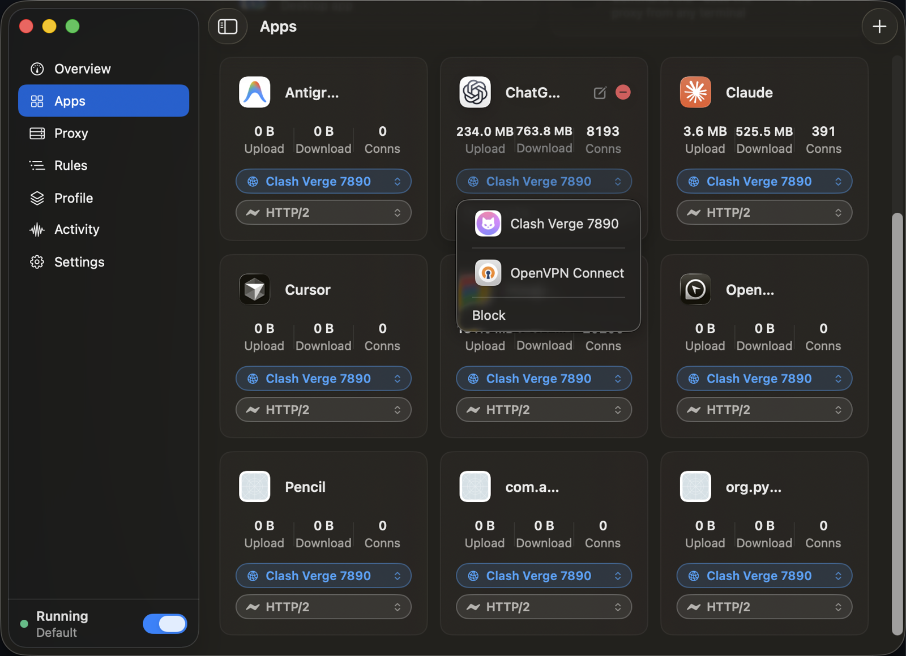
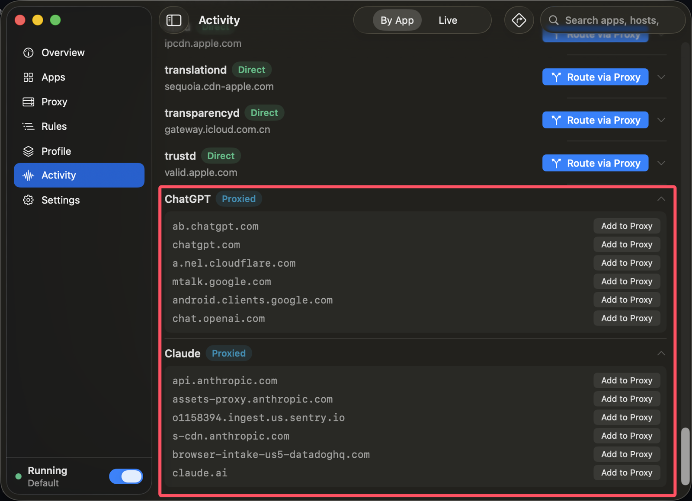
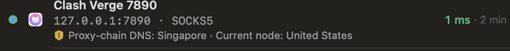

# ProxyRouter for macOS

**English** · [简体中文](README.zh-CN.md) · [Русский](README.ru.md)

**A local per-app proxy router for Mac.** Give each application its own network path: one app through a SOCKS5/HTTP proxy, another through a VPN tunnel, the rest direct, or blocked. All at the same time, no switching.

**Website and download: <https://proxyrouter.app>**

> This repository holds documentation only. ProxyRouter is closed-source software distributed as a signed and notarized DMG from the website above.



## What problem it solves

macOS has one default route and one system proxy switch. When a server VPN, a client's intranet VPN and a local proxy (Clash, sing-box, a corporate gateway) are all on, they fight, and you spend the day turning things on and off.

ProxyRouter decides **per application, at the moment a connection is created**, which path it takes. Several VPNs and proxies stay up together and every app uses its own.

Typical layout:

| App | Path |
|---|---|
| Terminal (SSH, rsync, kubectl) | Server-room VPN tunnel |
| Database client, Git client | Client intranet VPN tunnel |
| Browser, AI tools, package managers | Local proxy (SOCKS5/HTTP) |
| Slack, system updates, LAN apps | Direct |
| An app that must stay offline | Block (attempts stay visible) |

Step-by-step guide: [Use several VPNs and proxies at once](https://proxyrouter.app/multiple-vpn-proxy-at-once-macos)

## Features

- **Per-app routing** over SOCKS5 or HTTP upstreams. Pick apps by icon, no process names to type.
- **VPN tunnels detected automatically.** Once a VPN is connected, it shows up as a choice for any app.
- **UDP and QUIC.** SOCKS5 UDP ASSOCIATE, and QUIC with three explicit states: proxy it, force fallback to TCP, or go direct.
- **See every address each app connects to.** The Activity page lists, per app, all the hosts it talks to, live. See [below](#see-every-address-each-app-connects-to).
- **Block rules.** Close an app's connections outright and still see the blocked attempts.
- **Automatic profile switching per network.** Wi-Fi by SSID, wired by gateway MAC plus subnet.
- **Explainable connections.** Every connection shows which rule matched and why, and a dry-run tester answers the same question without sending a packet.
- **Leak protection.** WebRTC/UDP and DNS leak handling, and a [DNS check](#dns-check-does-your-dns-match-your-exit) that compares your DNS resolver with your network exit.
- **Automation.** `proxyrouterctl` CLI, URL scheme, App Intents and a built-in MCP server for LLM agents.

## See every address each app connects to

Not sure what an app is talking to? Open the **Activity** page. **By App** groups connections per application, and each app expands into the full list of hosts it has connected to. **Live** shows connections as they happen, and the search box filters by app or host.



- Each app carries its current state (**Direct**, **Proxied**), so you can see at a glance which apps are leaving your Mac without a proxy.
- Every host has an **Add to Proxy** button: found an address that should go through the proxy? One click and it does.
- An app that is still direct has a **Route via Proxy** button: one click moves the whole app.
- Each connection can be expanded to show which rule matched and why. A blocked app still lists its blocked attempts, so you can see where it was going.

Useful for finding what an AI tool, an updater or an unknown background process actually contacts, before you decide where it should go.

## DNS check: does your DNS match your exit?

A proxy can hide your IP and still leak where you are through DNS. If your traffic exits in the United States but the DNS queries behind it are answered by a resolver in Singapore, or back in your own country, sites and DNS operators see two different locations. ProxyRouter checks exactly this, **whether the DNS resolver that answers your queries is in the same place as your network exit**, and tells you on the Proxy page, under each proxy.



It reports three separate observations, so you can tell where a problem comes from:

1. **Local DNS.** A random-name lookup that does not go through the proxy, as a baseline for your own network.
2. **Proxy-chain DNS.** The same kind of lookup handed to your proxy. If the proxy is `127.0.0.1` (for example Clash or Mihomo), this is the final behavior of the whole chain behind it.
3. **Current node exit.** The public exit you get through the same proxy chain.

Result:

- **Clean.** The resolver and the exit agree.
- **Location mismatch.** The resolver is in a different country from the exit, but it is not your real location.
- **Leak.** The resolver, or the client subnet it forwards, points back to your own network while the exit is abroad.

How it works: ProxyRouter generates a random, never-seen subdomain and hands the **name itself** to the proxy, so nothing is resolved locally. The authoritative DNS server records which resolver asked, and ProxyRouter compares that resolver's location with the exit's. When the proxy entry is on `127.0.0.1`, a bad result is attributed to the local proxy client's DNS settings, not blamed on the remote server.

It runs automatically when you open the Proxy page (results are cached for 30 minutes). Click the line, use the right-click menu, or "Test all" to run it again. From the terminal: `proxyrouterctl proxy dns-check [name]` (add `--json` for scripts). LLM agents can call the read-only MCP tool `check_proxy_dns`.

## What it is not

- Not a VPN and not a proxy service. No servers, no bandwidth, no IP addresses, no node list, no account that grants network access. You bring your own VPN clients and SOCKS5/HTTP upstreams.
- It does not hide your identity or bypass geographic restrictions, and it is not marketed for that.

## Requirements

macOS 13 or later, Apple Silicon and Intel. Details: [system requirements](https://proxyrouter.app/system-requirements).

## Install

### One command

```sh
curl -fsSL https://raw.githubusercontent.com/kogodm/proxyrouter-macos/main/install.sh | bash
```

The script ([`install.sh`](install.sh), short enough to read first) does this:

1. Downloads the current release DMG from `https://proxyrouter.app/downloads/ProxyRouter.dmg` over HTTPS.
2. Mounts it read-only and checks that the code signature is valid, that the bundle id is `com.proxyrouter.app`, that the signing team is the expected one, and that Gatekeeper accepts the app (notarized). If any check fails, nothing is installed.
3. Copies `ProxyRouter.app` to `/Applications` and opens it.

Options, for a downloaded copy of the script:

```sh
./install.sh --dir ~/Applications   # install somewhere else
./install.sh --dmg ~/Downloads/ProxyRouter.dmg   # use a DMG you already have
./install.sh --no-open              # do not launch afterwards
./install.sh --force                # replace even if ProxyRouter is running
```

If `/Applications` is not writable for your account, use `--dir ~/Applications` or run with `sudo`. The script refuses to replace a running app: quit ProxyRouter first. Once installed, the app updates itself in-app, so you do not need to run the script again.

### Manual

Download the DMG from <https://proxyrouter.app/download>, open it, and drag **ProxyRouter** to Applications. It is signed with a Developer ID certificate and notarized by Apple.

A free trial with all features is available, no card required.

## First launch

1. Open ProxyRouter. macOS asks you to allow its network system extension. Approve it once.
2. If macOS asks to allow a DNS proxy configuration, click **Allow**.
3. The sidebar toggle at the bottom shows **Running** when routing is active.

## Use

1. **Proxy page.** Add your SOCKS5 or HTTP upstream (a local Clash port, a corporate gateway). Connected VPN tunnels appear under **VPN tunnels (detected automatically)**.
2. **Apps page.** For each app, open the path menu and choose a proxy, a VPN tunnel, or **Block**. An app with nothing chosen connects directly.
3. **Activity page.** Check the result: every connection shows the path it took and the rule that matched.
4. **Profile page.** Bind a profile to a network (Wi-Fi SSID, or wired gateway) so it applies automatically there.

An app pinned to a VPN reaches only what that VPN routes. If the VPN only pushes internal routes, the app's connections to public addresses fail instead of leaking, and if the VPN drops, the app's connections fail rather than taking another path.

Scripting and automation: `proxyrouterctl` CLI, URL scheme, App Intents and the built-in MCP server. See <https://proxyrouter.app>.

## Guides

- [Per-app proxy on macOS: how it works](https://proxyrouter.app/per-app-proxy-macos)
- [Route one app through a proxy](https://proxyrouter.app/route-app-through-proxy-macos)
- [Exclude apps from a VPN (split tunneling)](https://proxyrouter.app/exclude-apps-from-vpn-macos)
- [Use several VPNs and proxies at once](https://proxyrouter.app/multiple-vpn-proxy-at-once-macos)
- [Proxy UDP and QUIC on macOS](https://proxyrouter.app/proxy-udp-quic-macos)
- [How to use a SOCKS5 proxy on macOS](https://proxyrouter.app/socks5-proxy-macos)
- [Proxifier alternative for Mac](https://proxyrouter.app/proxifier-alternative-mac)

## Support

Questions and bug reports: [support@proxyrouter.app](mailto:support@proxyrouter.app) or open an issue here.

---

© 2026 ProxyRouter. All rights reserved. [proxyrouter.app](https://proxyrouter.app)
