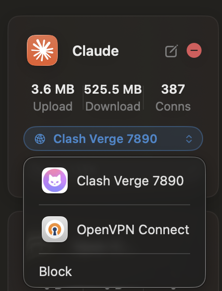

# ProxyRouter for macOS

**A local per-app proxy router for Mac.** Give each application its own network path: one app through a SOCKS5/HTTP proxy, another through a VPN tunnel, the rest direct, or blocked. All at the same time, no switching.

**Website and download: <https://proxyrouter.app>**

> This repository holds documentation only. ProxyRouter is closed-source software distributed as a signed and notarized DMG from the website above.

## What problem it solves

macOS has one default route and one system proxy switch. When a server VPN, a client's intranet VPN and a local proxy (Clash, sing-box, a corporate gateway) are all on, they fight, and you spend the day turning things on and off.

ProxyRouter decides **per application, at the moment a connection is created**, which path it takes. Several VPNs and proxies stay up together and every app uses its own.

Typical layout:

| App | Path |
|---|---|
| Terminal (SSH, rsync, kubectl) | Server-room VPN tunnel |
| Database client, Git client | Client intranet VPN tunnel |
| Browser, AI tools, package managers | Local proxy (SOCKS5/HTTP) |
| Slack, system updates, LAN apps | Direct |
| An app that must stay offline | Block (attempts stay visible) |

Step-by-step guide: [Use several VPNs and proxies at once](https://proxyrouter.app/multiple-vpn-proxy-at-once-macos)

## Features

- **Per-app routing** over SOCKS5 or HTTP upstreams. Pick apps by icon, no process names to type.
- **VPN tunnels detected automatically.** Once a VPN is connected, it shows up as a choice for any app.
- **UDP and QUIC.** SOCKS5 UDP ASSOCIATE, and QUIC with three explicit states: proxy it, force fallback to TCP, or go direct.
- **Block rules.** Close an app's connections outright and still see the blocked attempts.
- **Automatic profile switching per network.** Wi-Fi by SSID, wired by gateway MAC plus subnet.
- **Explainable connections.** Every connection shows which rule matched and why, and a dry-run tester answers the same question without sending a packet.
- **Leak protection.** WebRTC/UDP and DNS leak handling, and a proxy-chain DNS check.
- **Automation.** `proxyrouterctl` CLI, URL scheme, App Intents and a built-in MCP server for LLM agents.

## What it is not

- Not a VPN and not a proxy service. No servers, no bandwidth, no IP addresses, no node list, no account that grants network access. You bring your own VPN clients and SOCKS5/HTTP upstreams.
- It does not hide your identity or bypass geographic restrictions, and it is not marketed for that.

## Requirements

macOS 13 or later, Apple Silicon and Intel. Details: [system requirements](https://proxyrouter.app/system-requirements).

## Install

Download the DMG from <https://proxyrouter.app/download>. It is signed with a Developer ID certificate, notarized by Apple, and updates itself through Sparkle. A free trial with all features is available, no card required.

## Guides

- [Per-app proxy on macOS: how it works](https://proxyrouter.app/per-app-proxy-macos)
- [Route one app through a proxy](https://proxyrouter.app/route-app-through-proxy-macos)
- [Exclude apps from a VPN (split tunneling)](https://proxyrouter.app/exclude-apps-from-vpn-macos)
- [Use several VPNs and proxies at once](https://proxyrouter.app/multiple-vpn-proxy-at-once-macos)
- [Proxy UDP and QUIC on macOS](https://proxyrouter.app/proxy-udp-quic-macos)
- [How to use a SOCKS5 proxy on macOS](https://proxyrouter.app/socks5-proxy-macos)
- [Proxifier alternative for Mac](https://proxyrouter.app/proxifier-alternative-mac)

## Support

Questions and bug reports: [support@proxyrouter.app](mailto:support@proxyrouter.app) or open an issue here.

---

© 2026 ProxyRouter. All rights reserved. [proxyrouter.app](https://proxyrouter.app)
